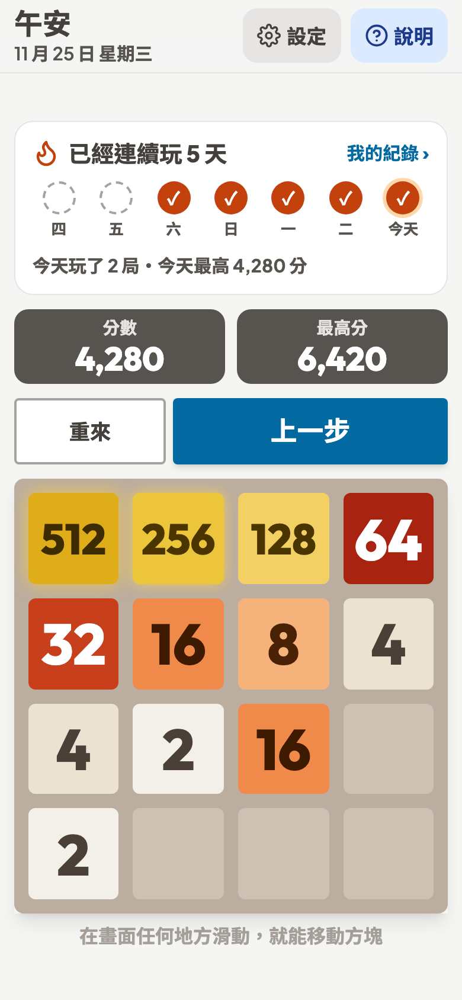
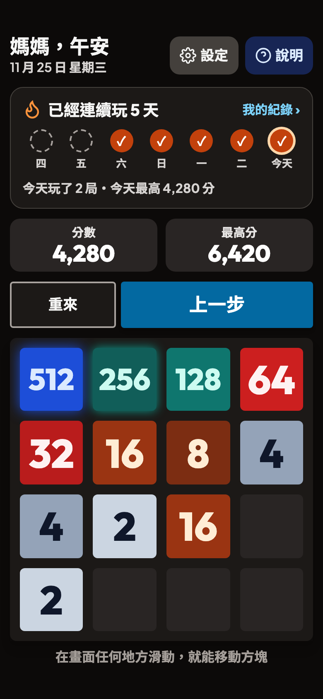

# 2048（給媽媽玩的版本）

做給媽媽在手機上玩的 2048 網頁版：大字、好按、沒有廣告、離線也能玩。  
玩法取自 [Gabriele Cirulli](https://github.com/gabrielecirulli/2048) 的經典開源遊戲 2048，這個專案是自己用 TypeScript 與原生 DOM 重寫、一步步針對長輩使用習慣調整出來的練習作品。

線上試玩：https://2048-drab.vercel.app

<p align="center">
  
  &nbsp;&nbsp;
  
</p>

## 針對長輩做的調整

- **問候與每日打卡**：頂部顯示時段問候與今天日期，第一次打開可填稱呼（只存在這支手機上）；打卡卡片記錄連續天數、近七天遊玩圓點與今日局數／最高分，點開可看完整紀錄與排行榜。
- **大字與高對比**：字體、按鈕與棋盤放大，矮螢幕自動收合卡片保住棋盤大小；淺色與深色模式下所有方塊文字對比度皆 ≥ 4.5（WCAG AA，由 `src/style.test.ts` 自動檢查）。
- **防誤觸操作**：「上一步」放大、「重來」縮小且需二次確認，沒有步數可退時「上一步」會顯示為停用；整個畫面都能滑動，從按鈕起手滑動也只會移動方塊，不會誤按按鈕。
- **溫和的結束與過關畫面**：無路可走時提示「沒有地方可以動了」，引導退回一步或再玩一局；破紀錄或拼出 2048 時放彩帶並自動以稱呼記入本機排行榜（可改名、同局不重複）。
- **放到手機桌面（PWA）**：支援加入主畫面與離線遊玩，內建 iPhone／Android 操作說明。
- **單一大字版面**：原本的一般（小字）版面已移除；棋盤大小（3×3～6×6）、音效、深色畫面、清除紀錄都在「設定」裡。
- **避開 iOS 狀態列模糊**：從主畫面打開時頂部多留空白，問候語不會被 iOS 26 狀態列下方的系統模糊蓋到。

## 基本功能

- 支援 3×3、4×4、5×5、6×6 四種棋盤，各自獨立保存進度、最高分與前五名紀錄（皆存於瀏覽器 `localStorage`）。
- 支援無限次「上一步」。
- 跟隨系統深淺色主題，也可手動切換鎖定。
- 使用 Web Audio API 合成基礎操作音效（可靜音），以及 Canvas 慶祝彩帶。

## 技術與專案結構

使用 Vite + TypeScript（strict）+ Tailwind CSS v4 + Biome + Vitest + vite-plugin-pwa，部署於 Vercel。

```text
index.html            頁面與對話框結構
public/               靜態圖示（Web App Manifest 由 vite-plugin-pwa 產生）
src/main.ts           畫面操作、事件與遊戲流程
src/game/logic.ts     移動、合併、結束判斷與字級（純函式＋單元測試）
src/game/stats.ts     每日局數、連續天數與七天圓點（純函式＋單元測試）
src/game/greeting.ts  時段問候、日期與打卡標題文字（純函式＋單元測試）
src/storage.ts        localStorage 存取封裝
src/effects/          Web Audio 音效與 Canvas 彩帶
src/style.css         主題色與版面樣式（對比由 style.test.ts 檢查）
```

## 本地開發

需要 Node.js 20.19 以上（建議 22）。

```bash
git clone https://github.com/Liang515/2048.git
cd 2048
npm install
npm run dev
```

| 指令 | 用途 |
| --- | --- |
| `npm test` | 執行單元測試 |
| `npm run lint` | Biome 檢查 |
| `npm run format` | Biome 格式化 |
| `npm run build` | 型別檢查並建置至 `dist/` |
| `npm run preview` | 預覽建置結果 |

## 致謝與授權

- 遊戲玩法致敬 [Gabriele Cirulli 的 2048](https://github.com/gabrielecirulli/2048)，其原始靈感來自 Asher Vollmer 的《Threes!》與 Veewo Studio 的《1024》。
- 長輩模式整合自先前獨立建立的 [senior-2048](https://github.com/Liang515/senior-2048)。
- 本專案採用 [MIT License](LICENSE)。
